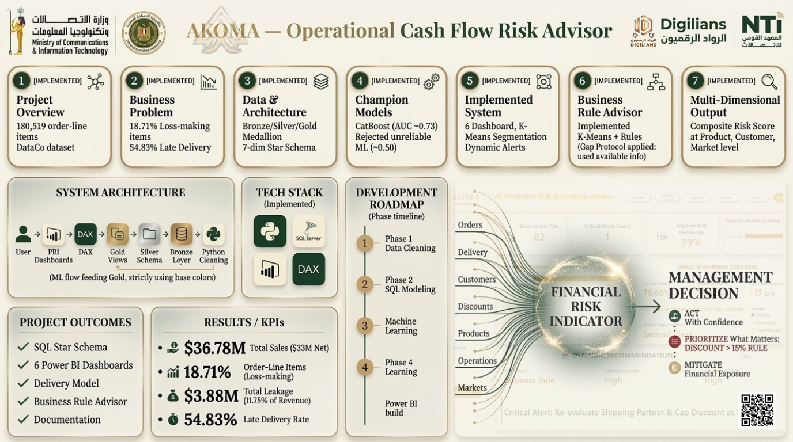

# 📦 AKOMA — Operational Cash Flow Risk Advisor
### DataCo Supply Chain · End-to-End Analytics & Risk Decision Support

A graduation capstone (Digilians – Digital Pioneers Initiative) built on the DataCo Supply Chain dataset. The team cleaned the data in Python, modeled it in SQL Server using a Medallion Architecture, and delivered six Power BI dashboards plus a risk advisor that turns delivery and discount behavior into financial-risk signals for management.



## 🎯 Business Problem
- **18.71%** of order lines are loss-making.
- **54.83%** of deliveries are late.
- Together they leak cash: **$3.88M** (11.75% of revenue) lost across the period.

The goal: show management where the financial exposure sits (by product, customer, and market) and which rules to act on first.

## 📊 Key Results
| Metric | Value |
|---|---|
| Total sales | $36.78M ($33M net) |
| Loss-making order lines | 18.71% |
| Total leakage | $3.88M (11.75% of revenue) |
| Late delivery rate | 54.83% |

## 🏗️ Architecture
`Python cleaning → Bronze → Silver → Gold (views) → DAX → Power BI dashboards`

- **Python:** data cleaning and exploratory analysis.
- **SQL Server (T-SQL):** Medallion Architecture (Bronze / Silver / Gold) with a 7-dimension star schema in the Gold layer.
- **Power BI + DAX:** six interactive dashboards on top of the Gold layer.
- **Machine learning:** results feed back into the Gold layer.

## 🤖 Machine Learning & Business Rules
- **Delivery-risk model:** CatBoost selected as the champion model (AUC ≈ 0.73). Models performing around 0.50 AUC were rejected as unreliable.
- **Segmentation:** K-Means customer/order segmentation.
- **Business Rule Advisor:** K-Means combined with rules (for example, flagging discounts above 15%).
- **Composite Risk Score:** calculated at product, customer, and market level, with dynamic alerts for management.

## 📈 Dashboards
Six Power BI dashboards covering the full flow: Overview, leakage and Discount, logistics, Markets, plus an ML-driven risk advisor dashboard. Files are in the `Power_Bi/` folder.

## 🗂️ Dataset
- **Total records:** 180,519 rows
- **Total columns:** 34 features
- **Primary key:** `Order Item Id`
- **Scope:** 65,752 orders across 20,652 customers and 118 distinct products
- **Dataset access:** [Download Raw Dataset from Google Drive](https://drive.google.com/file/d/1g15_fspTS7lPgt6wmRBTywG4HCDSC8N_/view?usp=sharing)

## 🛠️ Tools & Technologies
- **Python:** Pandas, NumPy, Scikit-Learn, CatBoost
- **SQL Server (T-SQL):** Medallion Architecture, star schema, views
- **Power BI & DAX:** dashboards and KPI measures
- **Jupyter Notebooks:** executable analysis and model pipelines

## 👥 Team Project & My Role
This was a team project. **My responsibility:** the SQL layer (Medallion Architecture and the 7-dimension star schema) and the Power BI dashboards. The Python cleaning and machine-learning components were developed by teammates.

## 📁 Repository Structure
```text
supply_chain_data_analysis/
│
├── akoma-infographic.png   # Project summary infographic
├── NoteBooks/              # Data cleaning, EDA & machine learning notebooks
├── SQL/                    # SQL queries and database scripts
└── Power_Bi/               # Power BI report files (.pbix)
```

## ✅ Project Outcomes
- SQL star schema
- 6 Power BI dashboards
- Delivery-risk model
- Business Rule Advisor
- Documentation
